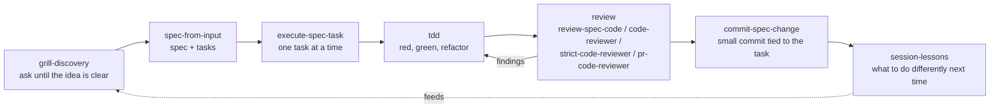

# spec-tdd-review-kit

A portable set of **rules, skills and subagents** that make an AI coding assistant work the way a careful team does: ask first, write a spec, split it into tasks, test first, review, commit small, and write down what was learned.

It works with **Cursor** and **Claude Code**. The kit is generic; everything specific to one company (repos, test commands, tracker, API client, feature flags) lives in a separate **company pack**. A fictional one is in [`examples/company-pack/`](examples/company-pack/README.md).

## The workflow



| Step | Skill / agent | What it does |
|---|---|---|
| Discover | `grill-discovery`, `project-discovery` | Interviews you one question at a time until requirements, risks and non-goals are explicit. |
| Specify | `spec-from-input`, `docs/spec-template.md` | Turns the discovery output (or a ticket) into a spec with tasks and acceptance criteria. |
| Plan | `technical-implementation-planner`, `technical-task-creator` | Maps the spec to repositories and creates engineering tasks, including shared-package bump follow-ups. |
| Build | `execute-spec-task`, `implement-ticket`, `tdd` | One task per run. Red first, minimal green, refactor. Manual check at the end. |
| Review | `review-spec-code`, `code-reviewer`, `strict-code-reviewer`, `pr-code-reviewer` | Reviews against the spec and the standards, from friendly to merciless. |
| Ship | `commit-spec-change` | Commits a spec change or a task with a clear message. |
| Learn | `session-lessons` | Writes a short lesson file so the next session starts smarter. |

Supporting rules: gated seam (new behaviour behind a flag in complex code), CQRS queries/commands, fix in central places, reuse existing code, model/factory investigation, feature maps, and a 4-step chained workflow for new projects. The reasoning behind them is in [`docs/philosophy.md`](docs/philosophy.md) and [`docs/engineering-standards.md`](docs/engineering-standards.md).

## Layout

```
core/
  agents/   7 subagents (reviewers, planner, task creator, ...)
  rules/    10 rules (.mdc)
  skills/   14 skills (SKILL.md folders)
docs/
  spec-template.md
  philosophy.md
  engineering-standards.md
examples/
  company-pack/   a fictional company pack (Acme Tickets)
scripts/
  install.mjs            link the kit into Cursor or Claude Code
  sync-agent-rules.mjs   generate CLAUDE.md and .cursorrules from AGENTS.md
  leak-check.mjs         fail on forbidden names, secrets and broken links
  leak-patterns.txt      what leak-check looks for
kit.config.json          settings (docs root, ticket pattern, targets, ...)
AGENTS.md                the entry point for assistants working in this repo
```

## Install

Requires Node 18+. No dependencies.

```bash
git clone <this repo> && cd spec-tdd-review-kit

# preview first, nothing is changed
node scripts/install.mjs --target cursor --dry-run

# install for Cursor (~/.cursor) or Claude Code (~/.claude)
node scripts/install.mjs --target cursor
node scripts/install.mjs --target claude

# with a company pack
node scripts/install.mjs --target cursor --pack examples/company-pack
```

What the installer does:

- Creates **symlinks** from the tool's folders to this repo, so `git pull` updates your setup.
- Rules keep the tool's extension: `.mdc` for Cursor, `.md` for Claude Code (the Claude link has a different name than the source file).
- **Never deletes.** If a real file or folder is in the way, it is moved to `<home>/.kit-backups/<timestamp>/` first.
- **Stays inside the repo and inside the target home.** Sources that resolve outside the repo are refused.
- Running it twice is safe: links that are already right are reported as `ok`.
- `--prune` removes only stale symlinks that point into this repo (for example after you rename a skill).
- `--home <dir>` installs somewhere else, useful for trying it out: `--home /tmp/try`.
- Two files with the same name in core and a pack are an error, not an override.

## Configure

`kit.config.json` is read by the scripts and referred to by the skills. To keep personal values out of git, create `kit.config.local.json`; it is merged over `kit.config.json` and ignored by git.

| Key | Meaning |
|---|---|
| `docsRoot` | Where specs, discovery notes and feature maps are written (`<docs_root>` in skills). |
| `secondBrain` | Optional folder of personal notes the discovery agent may read (`<second-brain>`). |
| `ticketPattern` | Regex for ticket IDs, used in commit messages and branch names. |
| `skipRedGreen` | Repos where strict red-then-green is not practical (tests are written in the same task, after). |
| `noCoverageRepos` | Repos where the strict reviewer should not ask for tests. |
| `targets.<name>` | Where a tool keeps its agents, skills and rules, and the rule file extension. Add your own tool. |
| `sync` | Source and outputs for `sync-agent-rules.mjs`. |

## Add a company pack

A pack is a folder shaped like `core/` (`agents/`, `rules/`, `skills/`) holding what only your company knows: repo names, layout, test commands, feature-flag naming, tracker mapping, API client conventions, shared packages. The core never mentions them; it says "the pack tells you".

1. Copy `examples/company-pack/` to `packs/<name>/`.
2. Rename files with a company prefix and replace the content.
3. `node scripts/install.mjs --target cursor --pack packs/<name> --dry-run`.
4. Keep real company packs in a **private** repo or a git-ignored folder. See [`examples/company-pack/README.md`](examples/company-pack/README.md).

## Keep one set of instructions for all tools

`AGENTS.md` is the single source. Generate the files other tools expect:

```bash
node scripts/sync-agent-rules.mjs --dry-run   # show what would be written
node scripts/sync-agent-rules.mjs             # write CLAUDE.md and .cursorrules (git-ignored)
node scripts/sync-agent-rules.mjs --check     # exit 1 if generated files are missing or stale
```

Generated files start with a "Generated by" header. If a file without that header is in the way it is copied to `.bak-<timestamp>` before being replaced. Writes never leave the repository.

## Leak check

Before you publish a fork, or a pack, run:

```bash
node scripts/leak-check.mjs
```

It fails on anything listed in [`scripts/leak-patterns.txt`](scripts/leak-patterns.txt) (company names, personal paths, internal ids, common secret shapes, and tool names that belong only in a pack) and on broken relative links or references to files that do not exist. Add your own patterns; the file is excluded from the scan. The same check runs in GitHub Actions on every push and pull request.

## Credits

- The spec-driven flow (discovery, spec, tasks, implement) follows the tutorial by **Owain Lewis** on spec-driven development with AI coding agents.
- The testing and refactoring guidance is paraphrased from the work of **Martin Fowler**, **Kent Beck** and **Michael Feathers**. No text is copied; read the originals.

## License

MIT. See [LICENSE](LICENSE).
